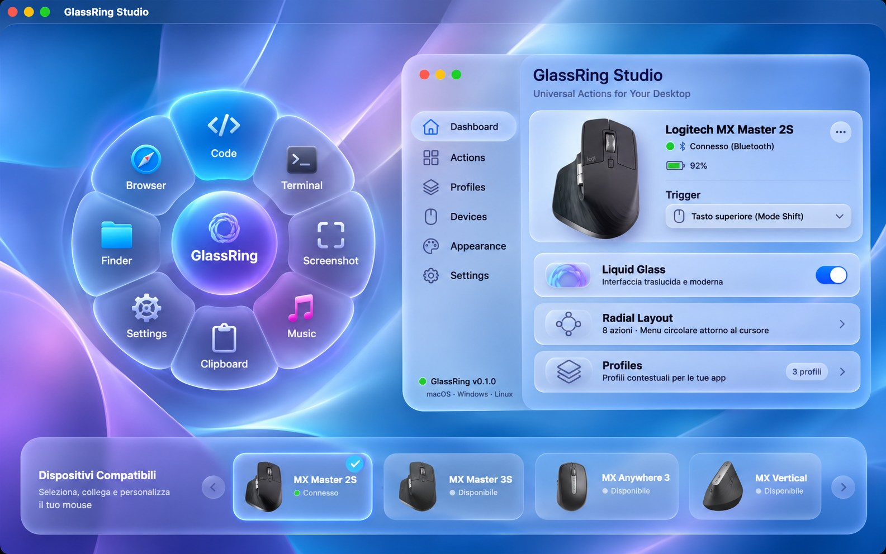

# GlassRing Studio — Actions Ring Liquid Glass

**Un launcher radiale open source per desktop**, sviluppato in Flutter/Dart. Il progetto nasce per attivare un menu personalizzato con il pulsante superiore del Logitech MX Master 2S e si estende a mouse e trackpad.

> **Versione 0.3.0 UI Preview.** Prototipo di laboratorio: macOS è stato provato con una versione precedente. Questa revisione richiede ancora test di compilazione sul Mac. Le funzioni indicate come sperimentali non sono garantite.



*Concept UI ufficiale approvato — rappresentazione grafica della direzione di design, non screenshot della release attuale.*

## Funzioni disponibili nel prototipo

- Nuova dashboard Flutter disegnata sulle proporzioni del concept ufficiale (1585×992): ruota a otto spicchi reali, barra laterale, pannelli Liquid Glass e fascia dispositivi interattiva.
- Scorciatoia globale **Control + Option + G** (macOS) quando l'app è in esecuzione.
- Apertura di app e strumenti tramite comandi del sistema operativo; una funzione potrebbe non essere disponibile su tutte le piattaforme.
- Catalogo dispositivi scorrevole con immagini illustrative ricavate dal concept approvato. La selezione è locale e **non** implica connessione.
- Configurazione del pulsante superiore tramite Logitech Options/Options+, quando disponibile.

## Limiti e stato dei test

- Il menu radiale è **dentro la finestra**, non ancora un overlay autonomo in corrispondenza del cursore.
- La dashboard usa un layout di riferimento scalabile: il design è orientato al desktop e può risultare piccolo sugli schermi stretti.
- Le immagini dei mouse sono ritagli dell'illustrazione del concept, non fotografie isolate dei prodotti.
- Il layout v0.3.0 è stato pubblicato come sorgente ma deve ancora essere compilato e provato dal Mac.
- Il catalogo non equivale al rilevamento automatico o al supporto completo di ogni mouse.
- Il ricevitore del Function Trackpad K304 è in analisi: la coppia USB `05AC:0265` è **un identificativo candidato**, non una firma esclusiva verificata.
- Bluetooth e collegamenti USB continuano a essere gestiti da macOS.
- Non sono implementate vibrazioni fisiche per l'MX Master 2S: manca un attuatore aptico.
- Windows e Linux sono obiettivi progettuali, non release collaudate.

## Requisiti

Flutter (canale stable), Dart, Xcode/CocoaPods per macOS. La versione minima macOS del progetto è **12.0**.

## Avvio su macOS

```bash
git clone https://github.com/GiovanniDelGaudio1994/ActionsRingLiquidGlass.git
cd ActionsRingLiquidGlass
flutter create --platforms=macos,windows,linux .
flutter pub get
flutter run -d macos
```

Se Xcode segnala un deployment target troppo vecchio, consultare [INSTALLAZIONE_MACOS.md](docs/INSTALLAZIONE_MACOS.md).

## Struttura

- `lib/main.dart`: avvio dell'app e configurazione della finestra.
- `lib/ui/concept_dashboard.dart`: rendering Liquid Glass, Ring a spicchi, interazioni e ritagli delle illustrazioni.
- `lib/services/azioni.dart`: modelli delle azioni e dei dispositivi e comandi desktop.
- `docs/ARCHITETTURA.md`: classi, responsabilità e flusso degli eventi, in italiano.
- `docs/COLLOQUIO_TECNICO.md`: domande con spiegazioni e limiti dichiarati.
- `assets/copertina-glassring.svg`: grafica originale vettoriale, non fotografia di prodotto.

## Licenza e marchi

Codice distribuito con **GNU AGPL-3.0-only** (consultare `LICENSE`). Logitech e Apple sono marchi dei rispettivi titolari; GlassRing è un progetto indipendente, non affiliato ai produttori. Non includiamo fotografie di prodotti prese da siti terzi senza licenza di redistribuzione.

**Autore:** Giovanni Del Gaudio · [Portfolio](https://giovannidelgaudio.it/) · [Profilo GitHub](https://github.com/GiovanniDelGaudio1994)
